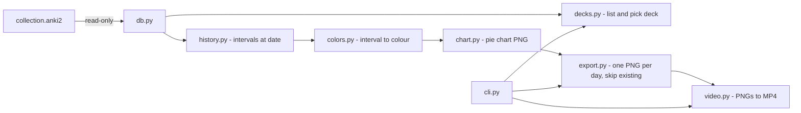

# ankivis – Implementation Plan

Every PR follows TDD: write tests → run them and confirm they **fail** → implement → confirm they **pass**.
Tests never touch the real Anki collection; they use a small synthetic SQLite fixture that mirrors the Anki schema
(`col`, `decks`, `cards`, `notes`, `revlog`).

## Tech stack

| Concern | Choice | Reason |
|---|---|---|
| Language | Python ≥ 3.12 | Anki's own ecosystem; stdlib `sqlite3` |
| Project / deps | `uv` + `pyproject.toml` (src layout) | Fast, reproducible lockfile |
| CLI | `typer` (or stdlib `argparse`) | Subcommands, typed options |
| Charts | `matplotlib` (Agg backend) | Headless PNG rendering |
| Video | `imageio[ffmpeg]` | Bundled ffmpeg binary, no system dependency |
| Tests / lint | `pytest`, `pytest-cov`, `ruff` | Standard |
| CI | GitHub Actions running ruff + pytest | Guards every PR |



Target layout:
```
src/ankivis/{__init__,__main__,cli,db,decks,history,colors,chart,export,video}.py
tests/conftest.py        # builds synthetic Anki DB fixture
tests/test_*.py
```

---

## PR 1 – Project skeleton ("hello, world")
- Create `pyproject.toml` (name `ankivis`, console script `ankivis = ankivis.cli:app`), `src/ankivis/`, `tests/`.
- Test first: `ankivis hello` (via typer's `CliRunner`) prints `Hello, world` and exits with code 0; `python -m ankivis --help` works.
- Implement the minimal CLI.
- Add ruff config, `.gitignore`, GitHub Actions workflow, and README usage section.

## PR 2 – List decks and pick one
- `db.py`: `open_collection(path)` opens a read-only SQLite URI connection (falls back to a temp copy if the file is locked); `default_collection_path(profile)` returns `~/.local/share/Anki2/<profile>/collection.anki2` (also supports `--collection` override).
- `decks.py`: `list_decks(conn) -> list[Deck(id, name)]`. It supports the modern `decks` table (names use `\x1f` as separator, shown as `::`) and the legacy JSON in `col.decks`.
- CLI: `ankivis decks` prints a numbered list; `pick_deck()` prompts for a number (or takes `--deck NAME|ID`). Subdecks are optionally included.
- Tests: fixture with 3 decks incl. a subdeck → correct names/ids, sorted; selection by number/name/id; invalid input re-prompts.

## PR 3 – Historical intervals
- `history.py`:
  - `end_of_day_ms(date, tz)` returns local 23:59:59.999 as epoch ms.
  - `intervals_at(conn, deck_ids, date) -> dict[card_id, float | None]` takes, per card in the deck, the latest revlog row with `id <= end_of_day_ms`. `ivl > 0` → days; `ivl < 0` → `-ivl / 86400` days; no row, or last row is a reset (`type == 4 and ivl == 0`) → `None` (unlearned).
  - Only cards that existed on that date are included (card `id` ≤ end of day).
  - `first_review_date(conn, deck_ids)` returns the date of the earliest revlog entry.
- Tests: hand-crafted revlog sequences (learning steps in seconds, reviews, lapses, reset, reviews after cutoff ignored, timezone boundary at 23:59 vs 00:00).

## PR 4 – Pie chart rendering
- `colors.py`: `interval_color(ivl) -> RGBA`
  - `None` → fully transparent
  - `≤ 1` → red; `≥ 730` (2 years) → blue
  - between → rainbow red→orange→yellow→green→blue (HSV hue 0°→240°), interpolated on a **log scale** (default, see open questions)
- `chart.py`: `render_pie(intervals, date, path)` sorts cards by interval so the colours flow as a smooth gradient; one wedge per card or per interval bucket. Adds a title with the date and counts, uses a transparent background, fixed size/DPI so video frames match.
- Tests: colour boundaries and monotonic hue; PNG is created with the expected dimensions; an empty/all-unlearned deck does not crash; wedge colours match input (inspect matplotlib artists).

## PR 5 – Daily image export
- `export.py`: `export_missing(conn, deck, out_dir, today)` iterates from `first_review_date` to yesterday. The file name is `YYYY-MM-DD.png`; days whose file already exists are skipped, and missing ones are rendered.
- CLI: `ankivis export --deck X --out DIR`, with a progress bar.
- Tests: tmp dir with some pre-existing files → only the missing ones are created (mock render); range bounds are correct; idempotent on second run.
- Optional: compute all days in a single pass over revlog for speed.

## PR 6 – Video
- `video.py`: `make_video(img_dir, out_path, fps=10)` sorts `YYYY-MM-DD.png` frames chronologically, flattens transparency onto a background colour (MP4 has no alpha), and writes H.264 MP4 via imageio.
- CLI: `ankivis video --in DIR [--out FILE] --fps N` (`--out` defaults to `DIR/progress.mp4`)
- Tests: 3 tiny frames → video file exists with 3 frames (read back via imageio); non-date files are ignored; an empty dir gives a clear error.

---

## Decisions
1. Rainbow interpolation: **log scale** between 1 and 730 days / 2 years (confirmed).
2. Cards not yet created on a date (card `id` > end of day): **excluded**, so the pie grows over time (confirmed).
3. Cards that exist but have not been learned yet (no revlog up to that date, or reset): **included as transparent wedges** (confirmed).
4. Suspended/buried cards: included, coloured by their interval (default).
5. Subdecks: included when a parent deck is picked (default).
6. Video fps: 10, configurable (default).
